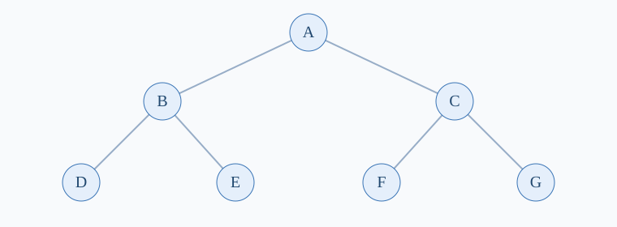

<a id="c0"></a>
# 第五章：二叉树——先看懂一棵树，再让程序沿着它走

<!--TOC-->
## 目录

- [学习路线与图片覆盖](#c1)
- [01 一棵树里，每个名词在说谁](#c2)
- [02 二叉树的“二”，究竟限制什么](#c3)
- [03 满二叉树、完全二叉树：别只凭“看着整齐”判断](#c4)
- [04 第一种数组存储：数组下标就是树上座位](#c5)
- [05 第二种数组存储：编号只是身份证，孩子关系自己记](#c6)
- [06 深度与高度：先约定根是第几层](#c7)
- [07 前序、中序、后序：不是走法不同，是记账时机不同](#c8)
- [08 层序遍历：排队访问，别让孙子插到叔叔前面](#c9)
- [09 重点模板：一次建树，调用四个独立函数](#c10)
- [10 用遍历结果反推一棵树](#c11)
- [11 二叉搜索树：形状随插入顺序，大小约束管整棵子树](#c12)
- [12 表达式树：运算符当父亲，操作数当叶子](#c13)
- [13 对照图片的十个应用位置](#c14)
- [14 复习：先画出来，再解释模板每一句](#c15)
- [来源与适配说明](#c16)

<!--/TOC-->


> 本章重点是概念、数组建树模板与四种遍历。先把一棵树读明白，再做应用题。

想象一本书的目录：上面的大标题连着下面的小标题。树也用“父—子”关系描述层次；二叉树额外规定每个位置最多有左、右两个孩子。它不是把数组画成树形就自动出现的，存储方法必须真的记住这些关系。

<a id="c1"></a>
## 学习路线与图片覆盖

| 图片内容 | 本章对应 | 重点 |
|---|---|---|
| 根、叶子、满与完全 | 01—03 概念 | 左右位置、层数约定与形状区别 |
| 淘汰赛、淘汰赛2、连续数组 | 04 顺序存储、P4715 | 位置2u/2u+1的成立条件 |
| 显式左右孩子、深度 | 05 建树、06 深度、P4913 | 编号和数值不是一回事 |
| 层次遍历、广度搜索 | 08 层序 | 数组队列 |
| 前/中/后序 | 07 DFS遍历 | 处理根的时机 |
| 美国血统、遍历问题 | 10 重建 | 哪些遍历组合能唯一确定树 |
| 二叉搜索树 | 11 BST | 查找、插入、中序有序 |
| 表达式树 | 12 表达式 | 前缀、中缀、后缀 |
| 医院设置 | 13 应用 | 把父子边当双向路走 |

建议先读01—08，照着同一棵树手写四行序列，然后运行模板；显式栈、BST和重建可第二遍读。完整代码都在本手册中，不需要来回打开多个笔记文件。

<a id="c2"></a>
## 01 一棵树里，每个名词在说谁



这一章统一用图中的A—G。A是根，B是A的左孩子，C是A的右孩子；D、E的父节点都是B，D与E互为兄弟。D、E、F、G没有孩子，叫叶子；A、B、C有孩子，叫内部节点。

“祖先”要沿父亲向上找：E的祖先是B、A；“后代”向下找：B的后代为D、E。以B为根的子树，包括B自己以及D、E，而不是只包括它的孩子。

| 名词 | 含义 | 例子 |
|---|---|---|
| 根节点 | 没有父节点的节点 | A |
| 叶子 | 没有孩子，度为0 | D、E、F、G |
| 节点的度 | 孩子个数 | A的度为2 |
| 路径 | 相邻节点之间连续走过的路线 | E→B→A→C→F |
| 路径长度 | 路径经过的边数 | 上一条长度4 |
| 子树 | 某节点和它全部后代 | B、D、E |

非空树有且只有一个根；除根以外每个节点恰有一个父亲。n个节点的树有n-1条边，任意两点间只有一条简单路径。若出现绕回原点的环、多父亲或互不连通，就不是这里假设的一棵树。输入合法性通常由题目保证，模板并不自动验证所有这些条件。

<a id="c3"></a>
## 02 二叉树的“二”，究竟限制什么

### 概念：最多两个孩子，而且左右有区别

不是每个节点必须有两个孩子，而是最多两个；可以没有、只有左、只有右，或左右都有。只有左孩子的树，与只有右孩子的树，形状不同。空树也是二叉树，递归里用编号0表示。

```text
  A          A
 /            \
B              B
只有左孩子     只有右孩子
```

因此，前序都为AB、后序都为BA，仍分不清这两棵树；后面的“遍历问题”正利用这个差别。

### 原理与使用场景

每个非空二叉树都能看成“根＋左子树＋右子树”，左右子树还各自是二叉树。这个定义天然递归，所以建树、统计深度和前中后序都能采用同一类函数结构。

若把节点按孩子数分成n0、n1、n2三类，边数既等于n-1，也等于n1+2n2。联立n=n0+n1+n2，可得非空二叉树的叶子数n0=n2+1。注意此式不要求满，也不要求完全；空树不能直接套。

<a id="c4"></a>
## 03 满二叉树、完全二叉树：别只凭“看着整齐”判断

本章采用国内教材常用定义：**满二叉树**是每层都填满的二叉树；高度h按层数算时，节点数2^h-1。每个内部节点有两个孩子，但这句话的反面不成立：内部都有两孩子，仍可能高低不齐。

**完全二叉树**则像按层排座位：前面各层都坐满，最后一层从左到右连续坐，不允许中间空一个再坐后面。

```text
满，也完全          完全但不满         不是完全
    A                  A                  A
  /   \              /   \              /   \
 B     C            B     C            B     C
/ \   / \          / \                /       \
D E  F G          D E                D         G
```

满二叉树一定完全，完全二叉树未必满。英文资料中的full/proper有时只指“每个内部节点恰有两个孩子”，不等于本节每层填满的perfect含义；做题以题面定义为准。

用途上的区别：完全形状适合顺序数组和堆；BST是值的大小约束，与是否完全是两件事；小根堆只保证父值不大于子值，也不等同BST的“整个左子树小、整个右子树大”。不要把三个概念揉成一个。

<a id="c5"></a>
## 04 第一种数组存储：数组下标就是树上座位

从根位置1开始，按层从左向右给座位编号，则左孩子位置2u，右孩子2u+1，父亲位置u/2。示例满树可以存成`A B C D E F G`，A在1、B在2、C在3。

```cpp
int left=u*2;
int right=u*2+1;
int father=u/2;
```

这些是**位置公式**，不是任意节点编号之间的规律！完全树正好连续使用1..n；普通树若有空位，必须保留空位，不能把后面的节点往前挤。

例如只有右孩子的链，位置为1、3、7、15……。只有h个节点，最大位置却到2^h-1，数组空间可能指数浪费。这就是普通树更常用显式孩子编号的原因。

淘汰赛是适合顺序存储的例子：2^k个选手放到叶层，内部节点记录该场比赛的胜者，最后根记录冠军。内部节点存的是胜者的**选手编号**，不是比赛节点自己的编号；这样才能回到原实力数组比较。

<a id="c6"></a>
## 05 第二种数组存储：编号只是身份证，孩子关系自己记

### 概念与表格

把每个节点分配一个编号u，分别用value[u]、lc[u]、rc[u]记录值、左孩子编号、右孩子编号。编号连续，只表示这些记录挨着放在内存里，不要求树的形状完全。

| 编号u | value[u] | lc[u] | rc[u] |
|---:|---|---:|---:|
| 1 | A | 2 | 3 |
| 2 | B | 4 | 5 |
| 3 | C | 6 | 7 |
| 4 | D | 0 | 0 |
| 5 | E | 0 | 0 |
| 6 | F | 0 | 0 |
| 7 | G | 0 | 0 |

这里恰好和位置编号相同，仅为了好看。把A改编号5、B改编号1也完全可以，只要lc/rc表同步改好。树有多少节点就用多少记录，左右孩子不必紧挨父节点。

### 建立与使用

建树首先是读入这些关系，不是必须调用new建立指针。若题目保证根是1，直接root=1；若不保证，用parent标记每个非空孩子，最后没父亲的节点就是根。完整模板build_tree返回这个编号。

```cpp
cin>>value[u]>>lc[u]>>rc[u];
if(lc[u]) parent[lc[u]]=u;
if(rc[u]) parent[rc[u]]=u;
```

0是空节点哨兵，真实节点从1编号。访问子树前先判断u==0；否则就可能把空节点当成真的节点继续递归。输入保证合法单树时不需要再写visited，因为每个节点只会被父亲递达一次；若输入其实有环，不能指望这份模板自己停下来。

### 可选：带空标记的前序建树

如果输入改成`A B # # C # #`（#表示空），可以边读边建。不能拿这一格式去读“每行给左右编号”的题，建树方式必须跟输入协议对应。

```cpp
int build()
{
    string s;
    cin>>s;
    if(s=="#") return 0;
    int u=++tot;
    value[u]=s;
    lc[u]=build();
    rc[u]=build();
    return u;
}
```

tot和数组需预先清零；这段示例与后文直接读编号的build_tree是两种替代方案，不要把两套输入方法同时执行。

<a id="c7"></a>
## 06 深度与高度：先约定根是第几层

本章/P4913按层数计：根深度1，孩子深度为父亲+1，空树高度0，单节点树高度1。示例树A最深走到D/E/F/G，共3层，所以整树深度为3。

若别处把根深度定义成0，那通常在按边数计，示例树会得到2。这不是算法冲突，而是计数起点不同；输出之前必须匹配题面。节点深度从根往下看，节点高度从它往最深叶看，别把两者当同一数组。

```cpp
int depth(int u)
{
    if(u==0) return 0;
    return max(depth(lc[u]),depth(rc[u]))+1;
}
```

左右子树高度分别求好，较高者加上自己这一层。例如D左右都是空，得到max(0,0)+1=1；B得到2，A得到3。这是后序思路：先要孩子的结果，才能组合父亲结果。

每个节点只处理一次，时间O(n)，递归空间O(h)。若树退化成长链，h=n，可能栈溢出。P4913有百万节点，后文使用BFS距离版，不让一百万层函数调用挤进系统栈。

<a id="c8"></a>
## 07 前序、中序、后序：不是走法不同，是记账时机不同

把自己想成去每个节点拜访的人：走进房间，先拜访左边，再拜访右边，最后离开。每个房间都有三次记账机会：刚到、左边回来、右边回来。三种遍历正是选择其中一次输出当前节点。

```text
刚进入u       ← 前序输出u
处理左子树
左边回来      ← 中序输出u
处理右子树
右边回来      ← 后序输出u
```

| 遍历 | 局部顺序 | 示例树结果 | 常见用途 |
|---|---|---|---|
| 前序 | 根、左、右 | A B D E C F G | 先得到父亲信息、前缀表达式 |
| 中序 | 左、根、右 | D B E A F C G | BST有序输出、中缀表达式 |
| 后序 | 左、右、根 | D E B F G C A | 子树统计、表达式求值、销毁树 |

“前中后”说的是根相对两棵子树的位置，不是数值排序，也不是“左中右三个方向”。普通二叉树中序并不保证数值升序。

### 手推中序：只盯住当前子树

进入A先不输出，去B；进入B也先不输出，去D；D左边为空，输出D，再处理空右边，返回B；此时B左边完成才输出B，再去E，输出E。整棵B子树结束以后回A，此时才轮到A。

```text
已完成：D B E | A | 接下来处理C的子树
C的中序：F C G
合起来：D B E A F C G
```

递归调用不是把父函数从头重跑，而是回到暂停处继续。这一点和上一章回溯一样；这里没有试错，不需要撤销值或左右关系。

### 实现：只移动cout的位置

三份函数见09完整模板。递归都从`if(u==0) return`开始。前序cout在两次递归之前，中序夹在中间，后序在最后。每次调用处理一棵子树，不要在同一层把左右孩子直接输出后又递归，否则会重复。

三种遍历各O(n)时间、O(h)调用栈。空孩子检查的次数也只是线性数量，不会让整树枚举变成2^n；因为每个真实节点只递归到它的两个固定孩子，而不是在两种方案间重新枚举。

<a id="c9"></a>
## 08 层序遍历：排队访问，别让孙子插到叔叔前面

先把根A放入队列，出队一个节点，就把它的左孩子、右孩子依次加入队尾。

| 取出谁 | 新入队 | 取出后的待处理队列 | 累计输出 |
|---|---|---|---|
| A | B、C | B C | A |
| B | D、E | C D E | A B |
| C | F、G | D E F G | A B C |
| D | 无 | E F G | A B C D |

C虽然不是B的孩子，却必须排在B刚发现的D/E之前，这就是先进先出维护的层序。结果A B C D E F G。DFS的显式栈后进先出，不能把stack换成queue却继续声称输出前序。

实现沿用AcWing常见数组队列风格：hh指向下一个待取元素，tt指向最后一个已存元素，起点q[0]=root，循环hh<=tt。真实树的非空孩子各入队一次，队列容量n即可；0号空孩子不要入队。

层序O(n)时间，数组实现额外O(n)空间；若使用可回收的标准队列，活跃队列大小与最大宽度同阶。完整模板的数组虽然队头前进，旧格子没有回收，因此仍预留n个位置。

<a id="c10"></a>
## 09 重点模板：一次建树，调用四个独立函数

**先运行这一份。** 输入n（0..1000），接着第u行给节点u的“值 左孩子编号 右孩子编号”；值是无空格字符串，空孩子为0，保证是合法单树。自动找根，不默认1。

```text
7
A 2 3
B 4 5
C 6 7
D 0 0
E 0 0
F 0 0
G 0 0
```

输出前序、中序、后序、层序各一行，最后一行输出按层计算的深度3。n=0时前四行为空、最后深度0。

```cpp
#include <bits/stdc++.h>
#define int long long
using namespace std;

const int N=1005;
int lc[N],rc[N],parent[N],n;
string value[N];
int build_tree()
{
    for(int u=1;u<=n;u++)
    {
        cin>>value[u]>>lc[u]>>rc[u];
        if(lc[u]) parent[lc[u]]=u;
        if(rc[u]) parent[rc[u]]=u;
    }
    for(int u=1;u<=n;u++)
        if(parent[u]==0) return u;
    return 0;
}
void preorder(int u)
{
    if(u==0) return;
    cout<<value[u]<<' ';
    preorder(lc[u]);
    preorder(rc[u]);
}
void inorder(int u)
{
    if(u==0) return;
    inorder(lc[u]);
    cout<<value[u]<<' ';
    inorder(rc[u]);
}
void postorder(int u)
{
    if(u==0) return;
    postorder(lc[u]);
    postorder(rc[u]);
    cout<<value[u]<<' ';
}
void levelorder(int root)
{
    if(root==0) return;
    int q[N],hh=0,tt=0;
    q[0]=root;
    while(hh<=tt)
    {
        int u=q[hh++];
        cout<<value[u]<<' ';
        if(lc[u]) q[++tt]=lc[u];
        if(rc[u]) q[++tt]=rc[u];
    }
}
int depth(int u)
{
    if(u==0) return 0;
    return max(depth(lc[u]),depth(rc[u]))+1;
}
signed main()
{
    cin>>n;
    int root=build_tree();
    preorder(root);
    cout<<'\n';
    inorder(root);
    cout<<'\n';
    postorder(root);
    cout<<'\n';
    levelorder(root);
    cout<<'\n'<<depth(root)<<'\n';
    return 0;
}
```

### 第二遍再读：不用函数调用栈的版本

独立程序`代码/01-显式栈与队列遍历.cpp`支持至多200000节点，输入相同，输出四种遍历，不再额外输出深度。它把尚未完成的工作放在数组栈中，适合深链。

前序：弹出自己就输出，**先压右再压左**，才能让左边先弹出。中序：沿左链不断压栈，走不动时弹出输出，再去右边。后序：栈顶的左边已经走完后，要检查右边是否也已处理；last保存刚完成的子树根，只有右孩子不存在或等于last时，才能输出当前根。last不是“上一个打印的数值”，而是节点编号。

下面展示中序函数；其余函数在同一个可编译程序中，逻辑与递归版逐项对应。

```cpp
void inorder(int root)
{
    static int st[N];
    int top=0,u=root;
    while(u||top)
    {
        while(u)
        {
            st[++top]=u;
            u=lc[u];
        }
        u=st[top--];
        cout<<value[u]<<' ';
        u=rc[u];
    }
}
```

<a id="c11"></a>
## 10 用遍历结果反推一棵树

### 前序+中序：先找到根，再切两边

前序ABDECFG的第一个A一定是根。在中序DBEAFCG里找到A，左侧DBE就是整棵左子树，右侧FCG就是整棵右子树。左边有3个节点，因此前序中根后面的3个BDE属于左子树，其余CFG属于右子树。

```text
前序：A | B D E | C F G
中序：D B E | A | F C G
后序：(D E B) (F G C) A
```

之后左右各自重复同样操作。节点标签互异时可唯一确定树；重复标签会让“找到哪个A”产生歧义，不能直接套这项唯一性结论。

### 前序+后序：为什么通常不唯一

前序AB、后序BA，看不出B在A左边还是右边。每个只有一个孩子的节点都有左右两种选择；有k个这种节点，就会产生2^k种对应中序结果。P1229标签互异且保证有解，利用前序相邻的父子在后序恰好反向相邻来识别这些单孩子节点。

不要背“任意两种遍历都能建树”。含中序且标签互异的前+中、后+中可以；只有前+后一般不行。若加了额外形状约束，结论才可能改变。

<a id="c12"></a>
## 11 二叉搜索树：形状随插入顺序，大小约束管整棵子树

BST要求：左子树所有值小于根，右子树所有值大于根，不只是两个直接孩子满足。以8为根，左孩子4、4的右孩子10，这不是BST，因为10仍处在8的左子树。

查6时，6<8向左，6>4向右，遇到6即找到；遇到空编号0即失败。插入就是执行同样的查找，最后把新节点挂到本应去的空位置。教学模板把重复值记在cnt[u]中，不再为相同值新建节点。

```text
插入8、4、10、6：
    8
   / \
  4  10
   \
    6
中序：4 6 8 10
```

BST中序有序，是因为左边全部小于自己、右边全部大于自己，加上对子树同样成立的归纳；普通二叉树不具备这条约束。

插入函数的`int &u`表示直接修改传入的孩子槽位/根变量；若按值传入u，给u分配编号只是改局部副本，父节点并不会连上新节点。

一次查找/插入O(h)，不是无条件O(log n)。升序插入1、2、3、4会退化为右链，h=n，批量插入最坏O(n²)。本教学接口建议q≤1000；递归插入/中序在深链上仍有栈风险，大规模需改显式循环或平衡树。本模板用于理解原理，不是平衡树，也不声称完整覆盖未核对的例7在线题接口。

```cpp
#include <bits/stdc++.h>
#define int long long
using namespace std;

const int N=100005;
int lc[N],rc[N],value[N],cnt[N],tot,root;
void insert(int &u,int x)
{
    if(u==0)
    {
        u=++tot;
        value[u]=x;
        cnt[u]=1;
        return;
    }
    if(x==value[u]) cnt[u]++;
    else if(x<value[u]) insert(lc[u],x);
    else insert(rc[u],x);
}
bool find(int u,int x)
{
    while(u)
    {
        if(x==value[u]) return true;
        if(x<value[u]) u=lc[u];
        else u=rc[u];
    }
    return false;
}
void inorder(int u)
{
    if(!u) return;
    inorder(lc[u]);
    for(int i=1;i<=cnt[u];i++) cout<<value[u]<<' ';
    inorder(rc[u]);
}
signed main()
{
    // 教学接口：q次操作，1 x插入，2 x查询，3输出中序。
    int q;
    cin>>q;
    while(q--)
    {
        int op,x;
        cin>>op;
        if(op==1)
        {
            cin>>x;
            insert(root,x);
        }
        else if(op==2)
        {
            cin>>x;
            cout<<find(root,x)<<'\n';
        }
        else
        {
            inorder(root);
            cout<<'\n';
        }
    }
    return 0;
}
```

<a id="c13"></a>
## 12 表达式树：运算符当父亲，操作数当叶子

例如(a+b)*c：根是最后执行的乘号，左子树是a+b，右叶子是c。前序得到*+abc（前缀），后序得到ab+c*（后缀），中序必须保留必要括号才能准确表达原运算顺序。

```text
       *
      / \
     +   c
    / \
   a   b
```

只输出普通中序字母，会得到a+b*c，变成先乘后加，含义已经不同。教学实现给每个运算子树加括号，得到((a+b)*c)，括号可能多，但语义正确。

从后缀ab+c*建树：遇a、b分别压入节点；遇+先弹出的是右孩子b，再弹出左孩子a，建立+节点压回；遇c压入，再遇*合并。减除对左右顺序敏感，不能把弹出顺序写反。

以下接口只支持合法的、长度≤1000、无空格后缀串，操作数为单字符字母/数字，运算符为二元+-*/。多位数字、负号、函数调用和错误输入需要额外的词法/语法规则，不是这份模板的处理范围。

```cpp
#include <bits/stdc++.h>
#define int long long
using namespace std;

int lc[1005],rc[1005],st[1005],tot,top;
char value[1005];
void pre(int u)
{
    if(!u) return;
    cout<<value[u];
    pre(lc[u]);
    pre(rc[u]);
}
void in(int u)
{
    if(!u) return;
    if(lc[u]) cout<<'(';
    in(lc[u]);
    cout<<value[u];
    in(rc[u]);
    if(lc[u]) cout<<')';
}
void post(int u)
{
    if(!u) return;
    post(lc[u]);
    post(rc[u]);
    cout<<value[u];
}
signed main()
{
    // 教学接口：合法后缀表达式；单字符字母/数字，二元运算+-*/，无空格。
    string s;
    cin>>s;
    for(char ch:s)
    {
        int u=++tot;
        value[u]=ch;
        if(ch=='+'||ch=='-'||ch=='*'||ch=='/')
        {
            rc[u]=st[top--];
            lc[u]=st[top--];
        }
        st[++top]=u;
    }
    int root=st[top];
    pre(root);
    cout<<'\n';
    in(root);
    cout<<'\n';
    post(root);
    cout<<'\n';
    return 0;
}
```

<a id="c14"></a>
## 13 对照图片的十个应用位置

本章不是把题解盖在概念上。先用前面模板理解，再按下面例题检查掌握程度。层次遍历与深度优先遍历两例已由09的同一完整程序覆盖；“淘汰赛2”图片未给独立题号，作为P4715的自底向上顺序存储实现讲解，不虚构另一套题面。

### P4715 例1/例2：淘汰赛与顺序存储

[洛谷原题](https://www.luogu.com.cn/problem/P4715)

2^n名选手放在m..2m-1的叶子位置，winner[u]保存这一场胜者的选手编号；从底向上比较两孩子。最后根的两个孩子是左右半区冠军，较弱者是亚军。亚军不一定是全体第二强：若最强与第二强在同半区，第二强早在决赛前被淘汰。O(m)时间与空间。

```cpp
#include <bits/stdc++.h>
#define int long long
using namespace std;

int strength[130],winner[260];
signed main()
{
    int n;
    cin>>n;
    int m=1LL<<n;
    for(int i=1;i<=m;i++)
    {
        cin>>strength[i];
        winner[m+i-1]=i;
    }
    for(int u=m-1;u>=1;u--)
    {
        int a=winner[u*2],b=winner[u*2+1];
        winner[u]=strength[a]>strength[b]?a:b;
    }
    int a=winner[2],b=winner[3];
    cout<<(strength[a]<strength[b]?a:b)<<'\n';
    return 0;
}
```

### P4913 例3：二叉树的深度

[洛谷原题](https://www.luogu.com.cn/problem/P4913)

本题保证根为1，按层数算深度。百万节点可能是一条链，因此用BFS而非百万层递归。d[1]=1，孩子d=父亲d+1，取最大值。O(n)时间空间，64位数组按实际大小估算。

```cpp
#include <bits/stdc++.h>
#define int long long
using namespace std;

const int N=1000005;
int lc[N],rc[N],q[N],d[N];
signed main()
{
    ios::sync_with_stdio(false);
    cin.tie(0);
    int n;
    cin>>n;
    for(int i=1;i<=n;i++) cin>>lc[i]>>rc[i];
    int hh=0,tt=0,ans=0;
    q[0]=1;
    d[1]=1;
    while(hh<=tt)
    {
        int u=q[hh++];
        ans=max(ans,d[u]);
        if(lc[u])
        {
            d[lc[u]]=d[u]+1;
            q[++tt]=lc[u];
        }
        if(rc[u])
        {
            d[rc[u]]=d[u]+1;
            q[++tt]=rc[u];
        }
    }
    cout<<ans<<'\n';
    return 0;
}
```

### P1827 例6：美国血统

[洛谷原题](https://www.luogu.com.cn/problem/P1827)

输入第一行中序、第二行前序，输出后序。不要把读入次序想当然写反。函数参数(il,ir,pl,pr)表示两段闭区间，k是根在中序的位置，left=k-il决定前序怎么切段。最多26节点，线性找根的朴素O(n²)足够；递归栈O(h)。

```cpp
#include <bits/stdc++.h>
#define int long long
using namespace std;

string in,pre;
void solve(int il,int ir,int pl,int pr)
{
    if(il>ir) return;
    char root=pre[pl];
    int k=il;
    while(in[k]!=root) k++;
    int left=k-il;
    solve(il,k-1,pl+1,pl+left);
    solve(k+1,ir,pl+left+1,pr);
    cout<<root;
}
signed main()
{
    cin>>in>>pre;
    solve(0,(int)in.size()-1,0,(int)pre.size()-1);
    cout<<'\n';
    return 0;
}
```

### P1364 例9：医院设置

[洛谷原题](https://www.luogu.com.cn/problem/P1364)

居民权重与节点编号不同。医院可设任意节点，居民也能向父亲走，所以父子链接要建双向边；只沿lc/rc向下遍历会漏路。枚举医院起点，各做一次BFS，累加人口×距离并取最小。n≤100时O(n²)时间、O(n)图空间足够，不必上来就写树形DP。

```cpp
#include <bits/stdc++.h>
#define int long long
using namespace std;

vector<int> g[105];
int w[105],d[105],q[105];
signed main()
{
    int n;
    cin>>n;
    for(int i=1;i<=n;i++)
    {
        int l,r;
        cin>>w[i]>>l>>r;
        if(l)
        {
            g[i].push_back(l);
            g[l].push_back(i);
        }
        if(r)
        {
            g[i].push_back(r);
            g[r].push_back(i);
        }
    }
    int ans=LLONG_MAX;
    for(int start=1;start<=n;start++)
    {
        memset(d,-1,sizeof d);
        int hh=0,tt=0,cost=0;
        q[0]=start;
        d[start]=0;
        while(hh<=tt)
        {
            int u=q[hh++];
            cost+=w[u]*d[u];
            for(int v:g[u])
            {
                if(d[v]!=-1) continue;
                d[v]=d[u]+1;
                q[++tt]=v;
            }
        }
        ans=min(ans,cost);
    }
    cout<<ans<<'\n';
    return 0;
}
```

### P1229 例10：遍历问题

[洛谷原题](https://www.luogu.com.cn/problem/P1229)

若前序中x紧挨着y在前、后序中y又紧挨着x在前，则x只有一个孩子，这个孩子子树根为y；否则两个孩子之间会夹着另一棵子树的后序。每个这样的节点让左右摆放产生二倍选择，最终2^k。标签互异且输入保证存在合法树是关键。O(n)时间、固定字符位置表空间。

```cpp
#include <bits/stdc++.h>
#define int long long
using namespace std;

string pre,post;
int pos[256];
signed main()
{
    cin>>pre>>post;
    for(int i=0;i<(int)post.size();i++) pos[(int)post[i]]=i;
    int ans=1;
    for(int i=0;i+1<(int)pre.size();i++)
    {
        if(pos[(int)pre[i]]==pos[(int)pre[i+1]]+1) ans*=2;
    }
    cout<<ans<<'\n';
    return 0;
}
```

<a id="c15"></a>
## 14 复习：先画出来，再解释模板每一句

1. 把示例树G删掉，它仍完全吗？是，最后一层从左连续；仍满吗？不是。
2. 只有根A和右孩子B，是完全二叉树吗？不是；只有左孩子则是。
3. 普通数组节点编号u，孩子能直接写2u吗？不能；只有顺序位置表示才这样。
4. 根深度按1算，空树高度是多少？0；单节点高度1。
5. 前序和层序在示例树上是否相同？不同；两者都先输出根，后面调度规则不同。
6. 前序AB与后序BA能决定B在左还是右吗？不能，两种情况都满足。
7. 递归后序可求树深度，能否直接对百万链运行？有栈溢出风险，改显式栈或BFS。
8. BST中序有序，能否反过来声称所有中序遍历都有序？不能，普通二叉树没有大小约束。

建议自己输入根编号不为1的小树，再画一条只有右孩子的链，比较递归版和显式栈版的四行输出。熟练后再尝试前+中重建与表达式树，先掌握函数含义，别直接背字符串下标。

<a id="c16"></a>
## 来源与适配说明

整理日期2026-11-20。图示与讲解独立编写。数组建树与显式栈思路复用仓库已有[数组二叉树专题](../../算法学习手册/章节/02-数据结构.md)，再按你的C++格式重写；BFS沿用本地yxc/AcWing数组队列习惯。未把新编写的BST/表达式树冒充AcWing官方原样。

五个题目规则按各节链接的洛谷原页核对。图中没有完整接口的“淘汰赛2”、例4/5、BST、表达式树采用已明确说明的教学/模板接口。本地验证不代表在线评测通过。
